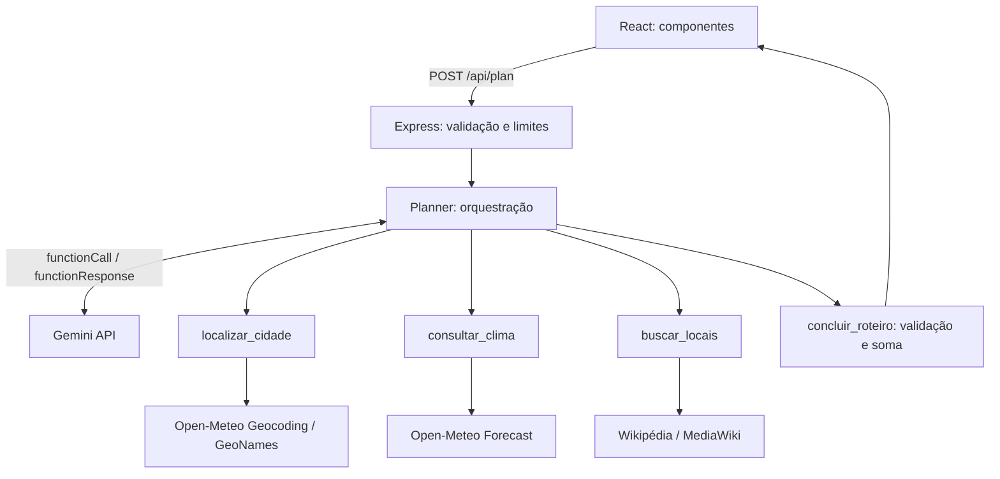

# Bora Lá

**Um rolê com a sua cara. E com o seu bolso.**

Planejador de passeios urbanos que combina orçamento, interesses e previsão do tempo. Projeto acadêmico com **React, Node.js, API do Gemini, function calling e APIs externas**.

- Lucas Cabrio - 04723-133
- Paulo Esteves - 04723-090


## Por que este projeto existe?

Escolher um passeio exige pesquisar lugares, clima e gastos em várias páginas. O Bora Lá concentra essas informações e propõe um roteiro curto, com plano B para chuva e valores estimados. O foco é lazer local acessível: a IA organiza informações externas em uma sugestão que o usuário consegue avaliar.

## Executar

Requisitos: Node.js 22 ou superior, npm, internet e uma chave Gemini com cota para o modelo configurado.

```powershell
npm install
Copy-Item .env.example .env
# Edite .env e preencha GEMINI_API_KEY
npm run dev
```

Abra **http://localhost:5173**. Nesta máquina, o `.env` já foi configurado localmente; **não substitua esse arquivo**. Ele é ignorado pelo Git. Nunca use prefixo `VITE_` para a chave: isso exporia o segredo no navegador.

Para executar o build de produção local:

```powershell
npm run build
npm start
```

Abra **http://localhost:3001**. O servidor usa `127.0.0.1`, voltado à demonstração local. O modo demonstrativo não consulta APIs, mas a aplicação ainda precisa estar rodando. As fontes do Google são opcionais, com fontes de sistema como alternativa.

## Como usar

1. Informe apenas o nome de uma cidade brasileira, por exemplo Curitiba.
2. Escolha hoje ou amanhã, orçamento **por pessoa**, quantidade de pessoas e interesse.
3. Clique em **Encontrar meu próximo rolê**. A geração pode levar alguns minutos.
4. Confira paradas, fontes, clima, gastos estimados e plano B.
5. Abra **Por trás do roteiro** para visualizar as funções executadas.
6. **Salvar roteiro** baixa um TXT. **Explorar um exemplo** abre dados ilustrativos identificados.

## Arquitetura



Não há banco de dados nem login. Formulário e resultado ficam no estado React e são descartados ao atualizar a página. A chave fica somente no backend. Cada roteiro usa um contexto novo, sem histórico entre usuários.

### Function calling real

O servidor envia declarações e esquemas para o Gemini. O modelo responde com `functionCall`. O backend executa a função permitida e envia `functionResponse`. O ciclo continua até `concluir_roteiro`.

| Função | Papel |
| --- | --- |
| `localizar_cidade()` | Converte a cidade em coordenadas e fuso. |
| `consultar_clima()` | Obtém mínima, máxima e probabilidade de chuva. |
| `buscar_locais()` | Busca artigos até 10 km do centro, priorizando títulos turísticos. |
| `concluir_roteiro({...})` | Recebe argumentos estruturados e valida roteiro e orçamento. |

As três primeiras funções usam o contexto validado do formulário e não precisam de argumentos da IA. A última recebe título, resumo, orientações, paradas, IDs, horários, durações e custos. O servidor controla quais funções podem ser chamadas em cada etapa; não executa código arbitrário. O modo `ANY` exige chamadas de função. Partes originais do modelo e IDs são preservados, inclusive thought signatures.

Há no máximo oito rodadas. Uma saída final inválida gera retorno de erro para correção dentro desse limite. Falhas externas são apresentadas ao usuário, sem trocar dados reais por dados fictícios.

### APIs e limites

- **Gemini:** modelo configurável, padrão `gemini-3.5-flash`, testado com a chave fornecida. Cota e cobrança dependem da conta.
- **Open-Meteo Geocoding:** busca cidades brasileiras e seleciona o primeiro resultado. Cidades homônimas podem ser ambíguas; cidade e estado resolvidos aparecem no resultado.
- **Open-Meteo Forecast:** previsão diária para hoje/amanhã no fuso da cidade; não é previsão por horário nem garantia meteorológica.
- **Wikipédia:** artigos próximos, não um catálogo de preços ou funcionamento. Alternativa em inglês quando a busca em português falha ou fica vazia; títulos e links preservam a fonte.
- **Google Maps:** somente links para coordenadas; não usa API nem calcula rotas ou tempo de deslocamento.

Preços, duração e horários sugeridos são estimativas. O backend garante a soma dentro do orçamento, mas não o gasto real. Confirme acesso, horários e preços nos canais oficiais. Não há filtros verificados de acessibilidade, segurança de percurso ou disponibilidade. A preferência orienta a IA, sem garantir categoria para todos os locais.

## Código modularizado

```text
src/
  components/  Header, Hero, PlannerForm, PlanResult, ToolTrace, AboutDialog
  hooks/       usePlanner: requisição, loading, erro e exemplo
  data/        exemplo demonstrativo isolado
  lib/         formatação de moeda e datas
  App.jsx      composição da interface
  styles.css   layout responsivo
server/
  index.js     Express, limites e build
  services/    Gemini, localização, clima, locais e orquestrador
  tools/       declarações expostas ao Gemini
  lib/         HTTP, erros e validações
tests/         regras e protocolo de function calling
scripts/       teste de APIs, prints e geração do PDF
docs/          apresentação, validação e prints
output/pdf/    relatório acadêmico
```

## Testar

```powershell
npm test
npm run build
npm run check:apis
```

`check:apis` faz consultas reais, **consome cota do Gemini** e salva evidências na pasta ignorada `tmp/`. Testes unitários usam dependências simuladas. `scripts/capture.cjs` requer Playwright/Chrome e o app rodando; testa navegação, exemplo, download, erro, celular de 390 px e geração real. O PDF pode ser recriado com Python, ReportLab e Pillow: `python scripts/create_report.py`, após gerar as capturas.

Proteções acadêmicas: validação, corpo de 8 KB, três gerações simultâneas, cinco pedidos por IP por minuto, timeout nas APIs, funções permitidas por etapa e conferência de IDs/valores. Publicação exigiria autenticação, controle persistente de custos e revisão de infraestrutura.

## Material

- [Relatório PDF](output/pdf/Bora_La_Lucas_Cabrio_Paulo_Esteves.pdf)
- [Apresentação e perguntas](docs/APRESENTACAO.md)
- [Registro de testes](docs/VALIDACAO.md)
- [Prints](docs/screenshots)

## Referências e créditos

- [Gemini: function calling](https://ai.google.dev/gemini-api/docs/function-calling)
- [Open-Meteo: geocoding](https://open-meteo.com/en/docs/geocoding-api)
- [Open-Meteo: forecast](https://open-meteo.com/en/docs)
- [MediaWiki: geosearch](https://www.mediawiki.org/wiki/API:Geosearch)

Dados Open-Meteo (CC BY 4.0), GeoNames e Wikipédia. Interface e ilustração CSS/SVG produzidas para o projeto; ícones Lucide (ISC); fontes DM Sans e Manrope via Google Fonts (OFL).
