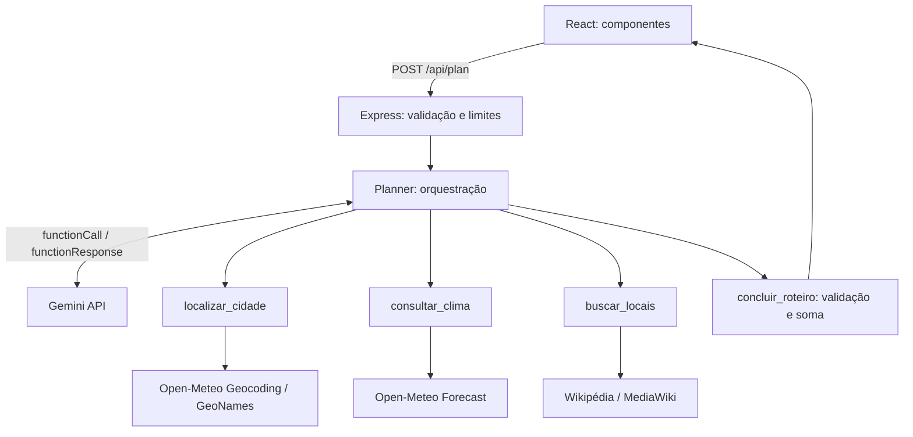

## Arquitetura

Não há banco de dados nem login. Formulário e resultado ficam no estado React e são descartados ao atualizar a página. A chave fica somente no backend. Cada roteiro usa um contexto novo, sem histórico entre usuários.

### Function calling real

O servidor envia declarações e esquemas para o Gemini. O modelo responde com `functionCall`. O backend executa a função permitida e envia `functionResponse`. O ciclo continua até `concluir_roteiro`.

| Função | Papel |
| --- | --- |
| `localizar_cidade()` | Converte a cidade em coordenadas e fuso. |
| `consultar_clima()` | Obtém mínima, máxima e probabilidade de chuva. |
| `buscar_locais()` | Busca artigos até 10 km do centro, priorizando títulos turísticos. |
| `concluir_roteiro({...})` | Recebe argumentos estruturados e valida roteiro e orçamento. |

As três primeiras funções usam o contexto validado do formulário e não precisam de argumentos da IA. A última recebe título, resumo, orientações, paradas, IDs, horários, durações e custos. O servidor controla quais funções podem ser chamadas em cada etapa; não executa código arbitrário. O modo `ANY` exige chamadas de função. Partes originais do modelo e IDs são preservados, inclusive thought signatures.

Há no máximo oito rodadas. Uma saída final inválida gera retorno de erro para correção dentro desse limite. Falhas externas são apresentadas ao usuário, sem trocar dados reais por dados fictícios.
